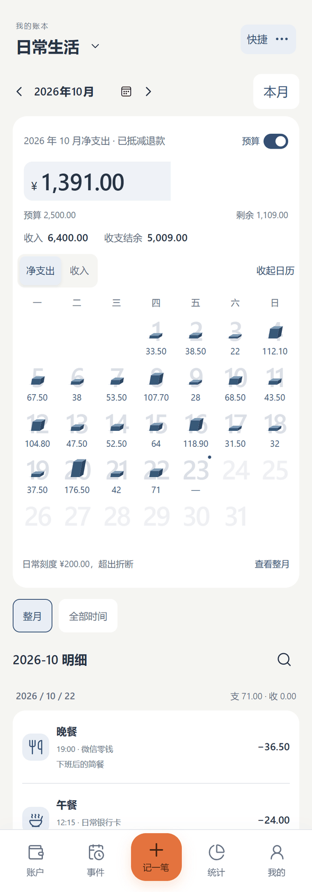
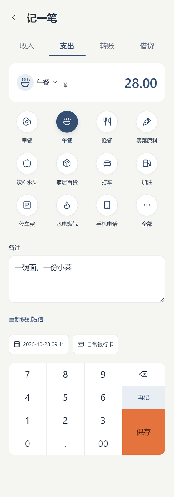
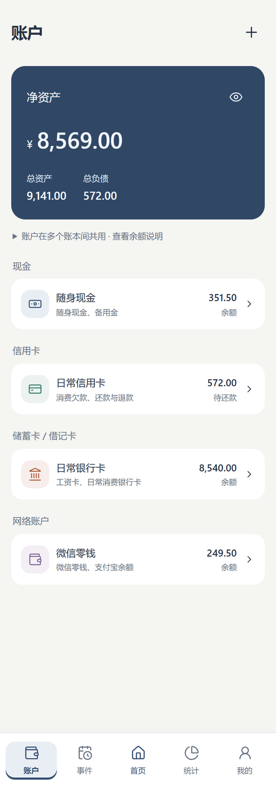

<p align="center">
  
</p>

<h1 align="center">BesLedger · Bes记账</h1>

先为自己做一本顺手的账：复制银行交易短信，粘贴后识别分类、资金账户、金额和交易时间，确认后保存。

BesLedger 是 Bes 系列的个人记账项目。作者已经习惯挖财记账，日常消费尽量集中通过一张银行卡支付，并利用银行交易短信隔几天集中补账。本项目优先减少逐笔选择账户、输入金额和调整日期时间的操作；项目以 MIT 协议开源；收到真实用户反馈后，再考虑扩展其他常见功能。

## 当前阶段

当前完整版本为 **0.1.3**：统一采用「日常钱包」图标，首页轻立体日历恢复原型的连续三面、配色与比例。包含五项底部导航、分步创建账户、分类选择反馈，以及本地加密记账、登录保持、设备保存同步密钥和跨端同步。

打开 [Web/PWA](https://bensonlaur.github.io/BesLedger/)，或下载 [Android 0.1.3 APK](https://github.com/BensonLaur/BesLedger/releases/download/v0.1.3/BesLedger-0.1.3-release.apk)（Android 10 起）。[0.1.3 完整版本页](https://github.com/BensonLaur/BesLedger/releases/tag/v0.1.3) 提供长期签名 APK、Web 生产包与 SHA-256。Android versionCode 11 已验签，与原正式预览包及 0.1.0–0.1.2 使用相同证书；升级前独立保存加密备份，直接覆盖安装，不先卸载或清空数据。提供 [Web/PWA 生产包](https://github.com/BensonLaur/BesLedger/releases/download/v0.1.3/BesLedger-0.1.3-web-pwa.zip) 和 [SHA-256 校验](https://github.com/BensonLaur/BesLedger/releases/download/v0.1.3/SHA256SUMS.txt)。0.1.2 及更早 Release 已清理，页面只保留 0.1.3，源码标签保留；旧版本信息见 [历史版本记录](docs/RELEASE_ARCHIVE.md)。

Web/PWA 已内置维护者提供的登录服务，普通用户无需注册托管账号、部署服务或填写地址。另有 [Cloudflare 备用 Web/PWA](https://besledger-bensonlaur.pages.dev/BesLedger/)。两个网址的本地存储相互独立；已有账目请继续使用原网址，需要迁移时使用加密备份或同步恢复密钥，不要清除原站点数据。

## 界面预览

以下为当前 0.1.3 构建实际运行的 Web/PWA 手机布局，与 Android 共用界面；首页柱体已按原型的连续三面、配色和比例重新绘制后截图。全部账本、账户和金额均为虚构演示数据；工资示例为 6,000 元，另有 400 元奖金。点击图片可查看大图。

| 收支日历与月预算 | 分类记账与数字键盘 | 账户与资产总览 |
| :---: | :---: | :---: |
| <a href="docs/images/preview-home.png"></a> | <a href="docs/images/preview-entry.png"></a> | <a href="docs/images/preview-accounts.png"></a> |

Android、Web/PWA、浏览器标签、创建/解锁页与“我的”现已统一使用「日常钱包」图标。当前 APK 为 versionCode 11，沿用原包名与长期签名，可覆盖升级。

## 登录、解锁与同步

- **只在本机记账，无需登录。** 资金账户（现金、银行卡等）、账本和 GitHub 登录账号相互独立，已有账本不必重建。
- **登录不会上传或覆盖账本。** 首次在 GitHub 安装 BesLedger Sync 并授权后，应用自动准备私有存储，无需手工建库或输入名称。上传哪本账、下载哪本账，由你选择；不同账本可以并存，同名不自动合并。
- **日常只需解锁本地账本。** 登录凭证在设备上加密保存，刷新、锁定解锁或重启后可恢复，令牌到期自动续期。主动退出或授权失效时需重新登录；断网本身不会退出。清除应用数据、卸载或更换设备后仍可能需要重新登录。
- **同步密钥验证一次后由设备记住。** 首次上传自动使用本机恢复密钥；新设备首次下载时输入原设备的同步恢复密钥，验证成功后加密保存。回到账本管理、锁定解锁或重启后无需反复输入。独立备份仍不可省略，换设备、恢复备份或主动忘记密钥后可能需要再次提供。
- **记住登录和密钥，不等于自动上传。** 修改账目后，进入账本管理点击“同步”；另一设备也需同步以获取更新。“已登录”只表示连接状态，账本的“已同步”才表示最近一次成功同步的结果。

默认安装选择 **All repositories**，令牌具备其他及未来仓库内容的读写能力。当前代码只使用确认过的账本存储，应用行为限制不等同平台隔离；也可自行选择 Only select repositories 限定范围，但首次须已有专用仓库。GitHub App 仅申请 Contents 写入、Repository creation 写入、Metadata 只读，已不使用旧 OAuth 的 repo 授权。

真实 GitHub App 登录、自动私有建库、Android 与 Web 双向同步及令牌续期已验收。0.1.3 的 73 项核心测试、相关界面与离线浏览器流程、20 组原型渲染像素对照，以及正式签名包从 0.1.2 到 0.1.3 的覆盖升级均通过；物理 Android/iPad 的验收仍待用户实测，不将模拟器或浏览器尺寸测试视为真机结果。产物与证据见 [逐项验收](docs/DELIVERY_VERIFICATION.md)，维护者配置见 [部署说明](docs/DEPLOYMENT.md)。

## 开始使用

1. 创建本地账本并设置解锁密码；独立保存恢复密钥，然后建立账户及期初金额。
2. 在“记一笔”的备注中粘贴短信，核对识别结果后保存。本地记账无需 GitHub。
3. 需要同步时，进入“我的 → GitHub 连接”，先阅读授权范围，再点击“在 GitHub 安装同步应用”，选择自己的账号及安装范围；返回应用点击“使用 GitHub 登录”，按页面设备码完成授权。这里安装的是 GitHub 账号中的同步应用，无需在手机上另装一个软件，也无需自己注册 GitHub App。
4. 应用自动准备云端私有存储。独立保存恢复密钥后，在账本管理点击该账本的“首次上传”。原有本地账目继续保留。
5. 在另一设备创建或解锁本地空间，登录同一 GitHub 账号。首次下载云端账本时，输入上传该账本的原设备同步恢复密钥，点击“解密并下载”；验证后设备会记住。不要把新设备自己的恢复密钥误当成原设备密钥。
6. 任一设备修改账目后点击该账本的“同步”，再在另一设备同步查看。不同本地账与云端账可以并存；同一笔记录发生并发冲突时，核对双方内容后选择，再同步。详见 [本地账本启用同步](docs/SYNC_MODEL.md#本地已有账本后开启-github-同步)。

保留完整加密备份和恢复密钥；同步不能替代独立备份。手机安装或浏览器使用问题可结合 [安全与恢复说明](docs/SECURITY_AND_RECOVERY.md) 排查。

测试分支已实现 0.1.4 的“忘记密码”：用本机恢复密钥设置新密码，保留已有账本与账目，Web 和 Android 均可离线完成。当前公开下载仍为上方 0.1.3；验证范围见 [安全与恢复](docs/SECURITY_AND_RECOVERY.md#忘记本机解锁密码)。

## 开发与构建

需要 Node 24 LTS。以下命令已实际运行：

```powershell
npm ci
npm test
npm run check
npm run dev
npm run build
npm run preview -- --port 4173
npm run test:e2e -- --project=desktop --project=android-layout
```

Web 访问 `/BesLedger/` 子路径，产物在 `dist/`；Android 使用 `dist-android/`，避免两个构建相互覆盖。PWA 首次完成资源缓存后可离线打开。浏览器测试使用本机 Edge；WebKit 项目需安装对应 Playwright 浏览器。

```powershell
npm run android:sync
# 使用 PowerShell 7，传入独立 JDK 21 与 Android SDK 的绝对路径
./scripts/build-android.ps1 -JavaDirectory <JDK目录> -SdkDirectory <SDK目录>
```

首次维护者发布需运行 `scripts/create-signing.ps1` 生成专用签名；已有签名禁止覆盖。详见 [安全与恢复](docs/SECURITY_AND_RECOVERY.md)。生产授权服务地址通过 `VITE_AUTH_SERVICE` 配置；应用注册缺失时不会模拟登录成功。

## 首要使用场景

1. 从短信应用复制一条银行交易通知，直接粘贴到记账页的备注。
2. 预填分类、资金账户、交易金额和交易时间，并保留原文供核对。
3. 区分明确识别、推断候选与缺失信息；对年份、账户歧义和未知分类给出简短提示。
4. 用户确认或修正后保存，再继续粘贴下一条短信。

目标是让常见格式、已配置账户和商家规则的单条短信，尽可能在约 10 秒内完成录入；这是待实机验证的体验目标，不是当前已经达到的指标。

## 技术实现

- Vue 3、TypeScript、Vite：共享 Web/PWA 界面，以 Capacitor 8 构建 Android APK；兼顾 iPad 网页。
- Web 使用 IndexedDB、Dexie.js，Android 使用原生 SQLite：本地保存加密数据，记账操作先在本机完成。
- GitHub 私有仓库：作为可选的加密同步存储；本地使用不强制登录。
- Web Crypto：封装加密、密钥恢复和完整性校验。
- 独立的业务、短信解析、存储与同步模块：具体选型边界见技术决策文档。

## 项目文档

| 文档 | 内容 |
| --- | --- |
| [产品定位](docs/PRODUCT.md) | 为谁解决什么问题、优先场景和范围 |
| [产品设计草案](docs/PRODUCT_DESIGN.md) | 页面流程、共用账户、基础借贷、统计与待确定细节 |
| [内置分类与排序](docs/CATEGORIES.md) | 通用分类清单、默认快捷项、固定“全部”入口和频率排序建议 |
| [技术栈决策](docs/TECH_STACK.md) | 技术基线、取舍、存储与授权边界 |
| [首页设计](docs/HOME_DESIGN.md) | 轻立体日历、明细联动、预算与新建账单时间 |
| [我的与同步设计](docs/MY_PAGE_DESIGN.md) | 登录状态、解锁、设备同步密钥及原型改版的行为要求 |
| [UI 源码快照](docs/prototypes/README.md) | 已确认页面的设计参考与原型边界 |
| [完整交付范围](docs/DELIVERY_SCOPE.md) | Web、Android、GitHub 登录与同步的验收标准 |
| [新会话执行任务](docs/EXECUTION_PROMPT.md) | 持续实施的完整目标、工程默认值和交付要求 |
| [短信录入流程](docs/SMS_WORKFLOW.md) | 四项核心识别信息、日期推断、分类和账户规则 |
| [短信访问边界](docs/SMS_ACCESS.md) | 粘贴与原生读取、法规依据、平台权限与分发条件 |
| [挖财导出结构](docs/WACAI_EXPORT.md) | XLSX 实测字段、借贷利息拆分、退款与迁移缺失信息 |
| [退款与周期记账](docs/REFUNDS_AND_RECURRING.md) | 挖财调研、已确认个人需求和暂缓的批量调整 |
| [同步模型](docs/SYNC_MODEL.md) | 唯一账本身份、四种主状态和异常处理 |
| [实施计划](docs/IMPLEMENTATION_PLAN.md) | 当前完成情况、后续阶段及验收方式 |
| [参考资料](docs/REFERENCES.md) | 挖财功能说明与技术官方文档 |
| [虚构短信样例](docs/examples/sms-recognition-cases.json) | 后续解析器的输入与预期行为草案 |

## 数据与许可

代码和原创文档采用 [MIT License](LICENSE)，沿用 BesFuel、BesMapLab、BesTools 的许可方式，版权署名为 BensonLaur。

真实账本、原始银行短信、截图、访问令牌和解密密钥不属于项目示例。私有调试资料放在已忽略的 `private/` 中；文档与公开样例只使用虚构数据。挖财的帮助文档、商标和界面素材仍归原权利人所有，功能参考不代表素材复制授权。

公开源码仓库、静态应用发布文件与用户的私有账本数据仓库分开管理。
